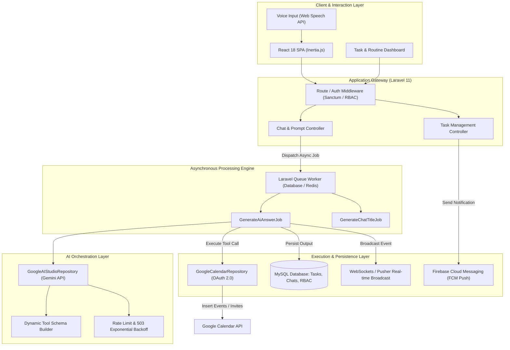

# VIRA 🤖
### Autonomous AI Executive Assistant & Developer Productivity Engine

[](https://laravel.com)
[](https://inertiajs.com)
[-4285F4?style=flat&logo=google)](https://ai.google.dev/)
[](https://developers.google.com/calendar)
[](https://firebase.google.com/)
[](LICENSE)

---

## Overview

**VIRA** is an event-driven **AI assistant and cognitive offloading engine** designed to streamline task execution, automate calendar scheduling, and minimize context switching for builders and engineers. 

VIRA treats natural language as an interface for **deterministic tool execution**. It parses user intent, extracts temporal and relational context, dynamically triggers external API tools (Google Calendar, notification queues, weather systems), and manages stateful task lifecycles through an asynchronous queue architecture.

---

## 🏛️ System Architecture



---

## ⚡ Core Capabilities & Engineering Highlights

### 1. Deterministic Tool Orchestration via Gemini Function Calling
* **Dynamic Tool Registry**: Implemented dynamic JSON Schema generator (`buildTools()`) in [`GoogleAIStudioRepository`](app/Http/Repositories/AiModels/GoogleAIStudioRepository.php) that serializes config-driven actions into strict OpenAPI parameters for Gemini.
* **Fault-Tolerant AI Pipeline**: Handles upstream Gemini rate limits (`429 Quota Exceeded`) and service degradation (`503 Service Overloaded`) using exponential backoff retry algorithms with configurable ceilings.
* **Deterministic Side-Effect Execution**: Decouples response generation from action execution. When tool calls are triggered, arguments are validated, translated to domain repositories, and executed transactionally.

### 2. Deep Calendar Integration & Schedule Automation
* **Google OAuth 2.0 Flow**: Integrated offline token lifecycle management ([`GoogleCalendarRepository`](app/Http/Repositories/Calendars/GoogleCalendarRepository.php)) to interact directly with primary user calendars without re-prompting.
* **Context-Aware Event Scheduling**: Resolves relative natural-language temporal expressions (e.g. *"Schedule a 45-minute sync with the backend team next Tuesday at 3 PM"*) into ISO-8601 timestamps, automatically handles timezones (`Asia/Kolkata`), and issues Google Meet invitations.

### 3. Decoupled, Asynchronous Job Queue Pipeline
* **Zero HTTP Blockage**: LLM inference and function calls are isolated from HTTP request lifecycles via queued jobs ([`GenerateAiAnswerJob`](app/Jobs/GenerateAiAnswerJob.php)).
* **Real-Time Event Broadcasting**: Integrates WebSocket event pipelines via Laravel Echo and Pusher ([`AnswerGeneratedEvent`](app/Events/AnswerGeneratedEvent.php)), broadcasting tokens and execution statuses back to the React UI with automatic client retry listeners.

### 4. Advanced Task & Routine Lifecycle Engine
* **Multi-Tiered Priority & Frequency**: Built a comprehensive relational task engine ([`tasks`](database/migrations/2024_08_28_184210_create_tasks_table.php), [`task_priorities`](database/migrations/2024_08_27_035037_create_task_priorities_table.php), [`task_frequency_units`](database/migrations/2024_10_26_113812_create_task_frequency_units_table.php)) supporting P0–P3 prioritization, due dates, time intervals, and recurring cadences (daily, weekly, custom intervals).
* **Push Notification Pipeline**: Connected via Firebase Cloud Messaging ([`FirebaseChannel`](app/Broadcasting/FirebaseChannel.php), [`ReminderNotification`](app/Notifications/ReminderNotification.php)) delivering timely task alerts to mobile and web clients.

### 5. Hands-Free Voice-First Interface
* **Continuous Speech Recognition**: Integrated Web Speech Recognition ([`InputForm.jsx`](resources/js/Components/Chatbot/InputForm.jsx), [`VoiceControl.jsx`](resources/js/Components/Chatbot/VoiceControl.jsx)) with real-time audio transcript streaming.
* **Smart Silence Detection**: Implemented a debounce heuristic that detects pauses in speech, auto-submits commands, resets buffer state, and triggers background tool execution hands-free.

### 6. Production-Grade SaaS Foundation
* **Monetization Engine**: Integrated Razorpay Subscriptions ([`SubscriptionController`](app/Http/Controllers/SubscriptionController.php)) supporting webhook verification, subscription status transitions (`pause`, `resume`, `cancel`), and tiered plan access.
* **Enterprise RBAC**: Built a flexible role-permission matrix ([`MasterModule`](app/Models/Main/MasterModule.php), [`Permission`](app/Models/Main/Permission.php), [`Role`](app/Models/Main/Role.php)) for granular authorization across resources.

---

## 🛠️ Tech Stack & Infrastructure

* **Backend Framework**: Laravel 11 (PHP 8.2+)
* **Frontend Architecture**: Inertia.js, React 18, Tailwind CSS, Framer Motion
* **AI Orchestration**: Google AI Studio API (Gemini 1.5/2.0 with Function Calling)
* **Calendar Engine**: Google APIs Client Library (`google/apiclient`)
* **Voice / Speech**: Web Speech API (`react-speech-recognition`)
* **Push Notifications**: Firebase Cloud Messaging (Kreait Firebase SDK)
* **Real-time Comms**: Laravel Echo, Pusher / WebSockets
* **Database & Caching**: MySQL 8.0, Redis (queue & cache drivers)
* **Payments & Billing**: Razorpay API & Webhook Signature Verification
* **Containerization**: Docker, Docker Compose

---

## 🚀 Getting Started

### Prerequisites
* PHP >= 8.2
* Composer >= 2.x
* Node.js >= 18.x & NPM
* MySQL >= 8.0
* Google Cloud Console Credentials (OAuth 2.0 with Calendar Scopes)
* Google AI Studio API Key

### Local Installation

1. **Clone the repository**:
   ```bash
   git clone https://github.com/your-username/vira.git
   cd vira
   ```

2. **Install dependencies**:
   ```bash
   composer install
   npm install
   ```

3. **Configure environment**:
   ```bash
   cp .env.example .env
   php artisan key:generate
   ```

4. **Set environment variables** in `.env`:
   ```env
   # Google AI Studio / Gemini
   GOOGLE_AI_STUDIO_BASE_URL="https://generativelanguage.googleapis.com/v1beta/models/gemini-pro:generateContent"
   GOOGLE_AI_STUDIO_API_KEY="your-gemini-api-key"

   # Google Calendar OAuth
   GOOGLE_CLIENT_ID="your-google-client-id"
   GOOGLE_CLIENT_SECRET="your-google-client-secret"
   GOOGLE_REDIRECT_URL="${APP_URL}/auth/google/callback"

   # Firebase Cloud Messaging
   FIREBASE_CREDENTIALS="storage/app/firebase-auth.json"

   # Razorpay (Optional for billing)
   RAZORPAY_KEY="your-razorpay-key"
   RAZORPAY_SECRET="your-razorpay-secret"
   ```

5. **Run migrations and seeders**:
   ```bash
   php artisan migrate --seed
   ```

6. **Start queue worker and development servers**:
   ```bash
   # Terminal 1: Queue Worker
   php artisan queue:work

   # Terminal 2: Laravel Server
   php artisan serve

   # Terminal 3: Vite Dev Server
   npm run dev
   ```

---

## 🔮 Engineering Roadmap (Towards Ambient Autonomy)

- [ ] **Ambient Calendar Defense Engine**: Heuristic algorithm that analyzes daily calendar fragmentation, calculates open windows ($\ge$ 90 mins), and automatically reserves `🛡️ Protected Focus Blocks`.
- [ ] **Slack Ingestion Gateway**: Socket Mode / Events API listener extracting implicit commitments from DMs and channels (*"I'll review the PR today"* $\rightarrow$ scheduled calendar task).
- [ ] **Chrome Side Panel Companion**: Manifest V3 extension bringing VIRA's action interface into the browser viewport alongside GitHub and Linear.
- [ ] **End-of-Day (EOD) Closeout Daemon**: Scheduled cron job that audits daily task completion, rolls over pending tasks, and presents a 2-minute voice debrief.

---

## 📜 License

This project is open-sourced under the [MIT License](LICENSE).
